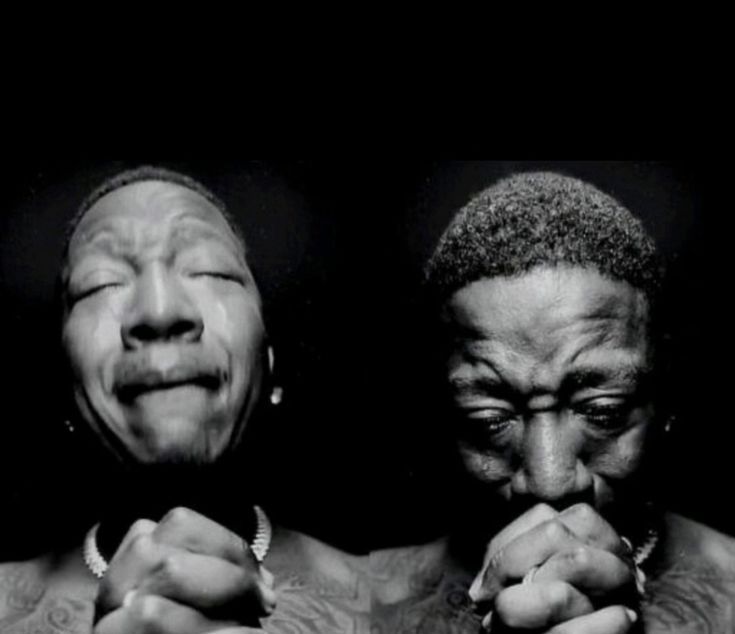
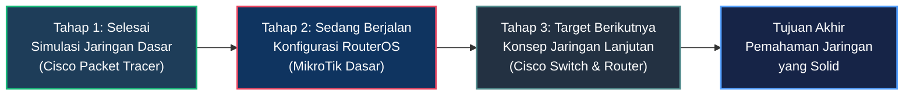

 

<table>
  <tr>
    <td width="68%" valign="top">
      <h3>About Me</h3>
      

        Halo! Saya <b>DrBham</b>, seorang pemula yang sedang fokus mempelajari dasar-dasar <b>jaringan komputer (Networking)</b> dan infrastruktur IT. Masih dalam proses awal membangun fondasi pemahaman, simulasi konfigurasi perangkat, dan troubleshooting sederhana.
      

      <ul>
        <li><b>Status:</b> Pemula / Beginner</li>
        <li><b>Fokus Saat Ini:</b> Dasar-dasar MikroTik RouterOS (IP, DHCP, Routing Dasar)</li>
        <li><b>Lab &amp; Eksperimen:</b> Cisco Packet Tracer &amp; VirtualBox</li>
        <li><b>Target Berikutnya:</b> Konfigurasi Switch &amp; Router Cisco</li>
        <li><b>Prinsip Belajar:</b> Praktik mandiri, analisis error, dan dokumentasi</li>
      </ul>
    </td>
    <td width="32%" align="center" valign="middle">
      
       
      <small><i>"Satu paket data dikirim, satu proses belajar bertambah."</i></small>
    </td>
  </tr>
</table>

---

### What I'm Learning

<table width="100%">
  <tr>
    <td align="center" width="33%">
       
      IP, DHCP, Routing Simpel &amp; Firewall
    </td>
    <td align="center" width="33%">
       
      Simulasi &amp; Topologi Jaringan
    </td>
    <td align="center" width="33%">
       
      Lab Virtual &amp; Eksperimen OS
    </td>
  </tr>
</table>

**Fondasi &amp; Konsep Dasar:**

`TCP/IP Model` &nbsp;•&nbsp; `Subnetting IPv4` &nbsp;•&nbsp; `Topologi Jaringan` &nbsp;•&nbsp; `Routing Dasar` &nbsp;•&nbsp; `Troubleshooting (Ping & Traceroute)`

---

### Learning Roadmap

---

  
   
  Terima kasih telah berkunjung ke profil GitHub saya.

