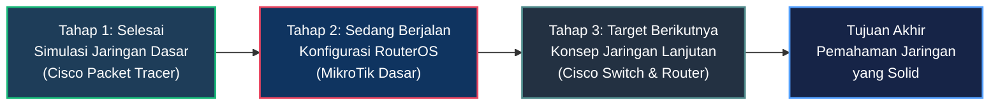

<br />

### 👤 About Me

Halo! Saya **DrBham**, seorang pemula yang sedang fokus mempelajari dasar-dasar **jaringan komputer (Networking)** dan infrastruktur IT. Masih dalam proses awal membangun fondasi pemahaman, simulasi konfigurasi perangkat, dan troubleshooting sederhana.

- 🌱 **Status:** Pemula / Beginner (Fokus Jaringan & IT)
- 📖 **Fokus Saat Ini:** Dasar-dasar MikroTik RouterOS (IP Address, DHCP, Routing Simpel, Firewall Dasar)
- 🧪 **Lab & Eksperimen:** Simulasi topologi di Cisco Packet Tracer & VirtualBox
- 🎯 **Target Berikutnya:** Konfigurasi mendalam perangkat Switch & Router Cisco
- 💡 **Prinsip Belajar:** Praktik mandiri, analisis error saat RTO, dan konsisten belajar

---

### 💻 Network Lab — ASCII Art

```
  *  ·  *  ·  *  ·  *  ·  *  ·  *  ·  *  ·  *  ·  *  ·  *

         ·    *    ·                        ·    *    ·
       ·   .-----.   ·                    ·   .-----.   ·
      *   /  SVR  \   *                  *   /  SVR  \   *
       · |  [ ][ ] |  ·                 · |  [ ][ ] |  ·
      *  |  [ ][ ] |  *                 * |  [ ][ ] |  *
       · |  [___]  |  ·                 · |  [___]  |  ·
      *   \_______/   *                  *  \_______/  *
         ·    |    ·                        ·    |    ·
              |                                  |
        .     |    .   .   .   .   .   .   .    |    .
       . ·    .--------  ROUTER  --------.    ·  .
       .      |   [::] =============== [::]  |     .
        . ·   |   [::] =============== [::]  |  ·  .
         .    .---------------------------------.    .
         ·                   |                  ·
         *           .-------·-------.          *
         ·          /                 \         ·
         *    .----.----.         .----.----.   *
         ·   |   SWITCH  |       |   SWITCH  |  ·
         *   |  ▓ ▓ ▓ ▓  |       |  ▓ ▓ ▓ ▓  | *
         ·    '-----------'       '-----------'  ·
         *    /    |    \          /    |    \   *
         ·  [PC] [PC] [PC]      [PC] [PC] [PC]  ·
         *   ·    ·    ·          ·    ·    ·    *

  *  ·  *  ·  *  ·  *  ·  *  ·  *  ·  *  ·  *  ·  *  ·  *
```

---

### 🛠️ What I'm Learning

<div align="center">

  
  &nbsp;&nbsp;
  
  &nbsp;&nbsp;
  

  <br /><br />

  `⚙️ IP, DHCP & Routing Simpel` &nbsp;•&nbsp; `🌐 Simulasi Topologi Jaringan` &nbsp;•&nbsp; `🖥️ Lab Virtual & Eksperimen OS`

</div>

<br />

**📚 Fondasi & Konsep Dasar yang Sedang Dipelajari:**
- 📡 **Protokol & Addressing:** TCP/IP Model, Subnetting IPv4, Default Gateway
- 🔌 **Arsitektur Jaringan:** Topologi fisik & logis, pengkabelan dasar
- 🔍 **Troubleshooting Dasar:** Pengujian koneksi (Ping, Traceroute), identifikasi status RTO

---

### 🗺️ Learning Roadmap



---

### 📬 Connect With Me

<div align="center">

  <a href="https://www.linkedin.com/in/drbham" target="_blank">
    
  </a>
  &nbsp;&nbsp;
  <a href="mailto:dimasreginal8@gmail.com">
    
  </a>

</div>

---

<div align="center">
  
  <br />
  <sub>Terima kasih telah berkunjung ke profil GitHub saya.</sub>
</div>
