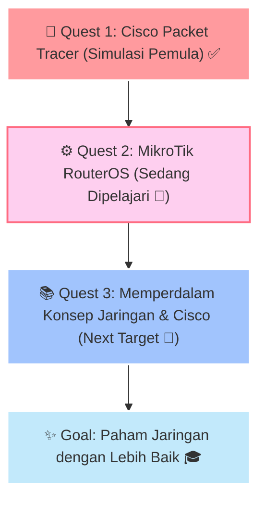

  <!-- Anime Banner / Header -->
  

  

    
  

  

  

    <i>"Satu paket data dikirim, sejuta doa semoga tidak Request Timed Out (RTO)... (´• ω •`)"</i>
  

---

### 🌸 About Me (Masih Pemula / Lv. 1 Trainee)

<table>
  <tr>
    <td width="70%" valign="top">
      <ul>
        <li>🌱 <b>Status</b>: Masih pemula / newbie yang lagi penasaran dan antusias di dunia komputer & jaringan (Networking).</li>
        <li>📖 <b>Sedang Dipelajari</b>: Dasar-dasar <b>MikroTik RouterOS</b> (belajar cara setting IP, DHCP, routing simpel, dan firewall dasar).</li>
        <li>🧪 <b>Eksperimen Sebelumnya</b>: Pernah coba-coba bikin simulasi topologi jaringan sederhana pakai <b>Cisco Packet Tracer</b>.</li>
        <li>🎯 <b>Target Kedepan</b>: Ingin belajar lebih dalam lagi tentang konsep & konfigurasi perangkat <b>Cisco</b> pelan-pelan.</li>
        <li>🍙 <b>Hobi Sampingan</b>: Nonton anime & ngulik hal-hal berbau teknologi.</li>
        <li>💬 <b>Prinsip Belajar</b>: <i>Trial, Error, RTO, Tanya Google, Ulangi lagi sampai ping-nya reply!</i> ٩(◕‿◕｡)۶</li>
      </ul>
    </td>
    <td width="30%" align="center" valign="middle">
      
    </td>
  </tr>
</table>

---

### 🎒 Yang Sedang Saya Pelajari & Coba (Learning Lab)

#### 🛠️ Alat / Software Simulasi & Praktik

#### 📝 Hal-Hal Dasar yang Sedang Diulik:
`Pengenalan TCP/IP` • `Subnetting Dasar` • `Kabel & Topologi Sederhana` • `Ping & Troubleshooting Awal`

---

### 🗺️ Quest Belajar Saya (Roadmap)

---

### 📊 Catatan Aktivitas GitHub

  
  

---

  <!-- Footer Banner -->
  
  
<i>Terima kasih sudah mampir ke profil saya! Mohon bimbingannya senpai~ (*/ω＼*)</i>

