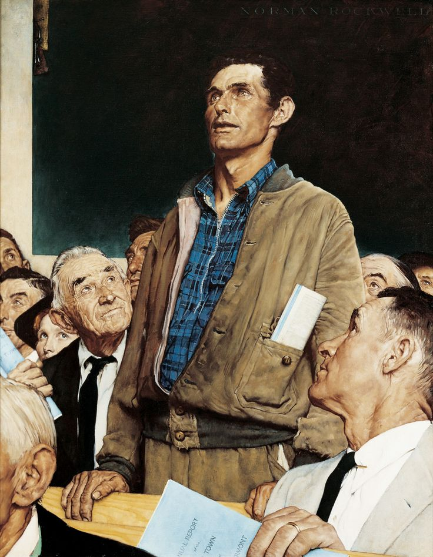

**⚔️ THE NETWORK APPRENTICE ⚔️**

*“Every great adventurer begins at level one.”*

---

### 📜 I. The Adventurer's Chronicle

<table>
<tr>
<td width="58%" valign="top">

**Greetings, traveler!** 👋

Saya **Dimas Reginald Bhamakerti**, seorang mahasiswa dan petualang pemula di dunia **Computer Networking**. Saat ini saya sedang menjelajahi dasar-dasar jaringan komputer, terutama **Cisco** dan **MikroTik**.

Saya masih belajar dan belum menjadi *network engineer* profesional. Saya sudah memperoleh sertifikasi **MTCNA (MikroTik Certified Network Associate)**, tetapi perjalanan belajar saya masih panjang: mencoba, salah konfigurasi, mencari penyebabnya, lalu mencoba lagi.

</td>
<td width="42%" valign="top">

**🛡️ Adventurer's Record**

| Scroll | Entry |
|:--|:--|
| **Class** | Networking Apprentice |
| **Rank** | Networking Learner |
| **Credential** | MTCNA Certified |
| **Interest** | Routing & Switching |
| **Mission** | Learn • Lab • Repeat |

</td>
</tr>
</table>

### 🏅 II. The Earned Insignia

<!-- Artwork floats to the far right; no headings or horizontal rules inside this section. -->

<big><strong>🏅 MikroTik Certified Network Associate</strong></big>

 

<strong>MTCNA · MikroTik</strong>

  

  

<strong>Issued:</strong> July 2026  
<strong>Expires:</strong> July 2029  
<strong>Credential ID:</strong> <code>2607NA1874</code>

 

*One milestone earned, many lessons still ahead.*

 

---

### 🧰 III. The Apprentice's Inventory

<table>
<tr>
<td align="center" width="20%">

 <strong>Cisco Packet Tracer</strong>
</td>
<td align="center" width="20%">

 <strong>MikroTik RouterOS</strong>
</td>
<td align="center" width="20%">

 <strong>VirtualBox</strong>
</td>
<td align="center" width="20%">

 <strong>GNS3</strong>
</td>
<td align="center" width="20%">

 <strong>GitHub</strong>
</td>
</tr>
</table>

### 🕯️ IV. Messages Beyond the Kingdom

*Have a tip, a learning resource, or a quest for a fellow beginner?*

 

**✦ Learn the basics. Explore the network. Enjoy the journey. ✦**

