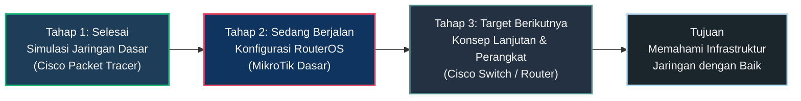

 

<table width="100%">
  <tr>
    <td width="62%" valign="top">

### About Me

Halo! Saya **DrBham**, saat ini sedang fokus mempelajari dasar-dasar **jaringan komputer (Networking)** dan infrastruktur IT. Masih dalam tahap awal belajar, membiasakan diri dengan konfigurasi dasar, simulasi lab, serta pemecahan masalah jaringan.

| Informasi | Keterangan |
| :--- | :--- |
| **Status** | Pemula / Beginner |
| **Fokus Saat Ini** | Dasar-dasar MikroTik RouterOS |
| **Lab & Eksperimen** | Cisco Packet Tracer & VirtualBox |
| **Target Berikutnya** | Konfigurasi Cisco Switch & Router |
| **Prinsip Belajar** | Praktik mandiri, analisis error, dan dokumentasi |

    </td>
    <td width="38%" align="center" valign="middle">
      
       
      <small><i>"Satu paket data dikirim, satu proses belajar bertambah."</i></small>
    </td>
  </tr>
</table>

---

### What I'm Learning

<table width="100%">
  <tr>
    <td align="center" width="33%">
       
      Dasar IP, DHCP, Routing Simpel & Firewall
    </td>
    <td align="center" width="33%">
       
      Perancangan & Simulasi Topologi Jaringan
    </td>
    <td align="center" width="33%">
       
      Simulasi OS & Testing Lingkungan Lab
    </td>
  </tr>
</table>

**Fondasi & Konsep Dasar:**

`TCP/IP Model` &nbsp;•&nbsp; `Subnetting IPv4` &nbsp;•&nbsp; `Topologi Jaringan` &nbsp;•&nbsp; `Routing Dasar` &nbsp;•&nbsp; `Troubleshooting (Ping & Traceroute)`

---

### Learning Roadmap

---

  
  Terima kasih telah berkunjung ke profil GitHub saya.

