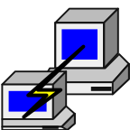

# ⚔️ Dimas Reginald Bhamakerti

**THE NETWORK APPRENTICE** · *Learning one lab at a time*

*✦ Explore networks · Build labs · Document the journey ✦*

---

### ⚒️ My Networking Toolkit

  &nbsp;&nbsp;&nbsp;&nbsp;
  &nbsp;&nbsp;&nbsp;&nbsp;
  &nbsp;&nbsp;&nbsp;&nbsp;
  &nbsp;&nbsp;&nbsp;&nbsp;
  

*⚔️ Every great adventurer begins at level one.*

